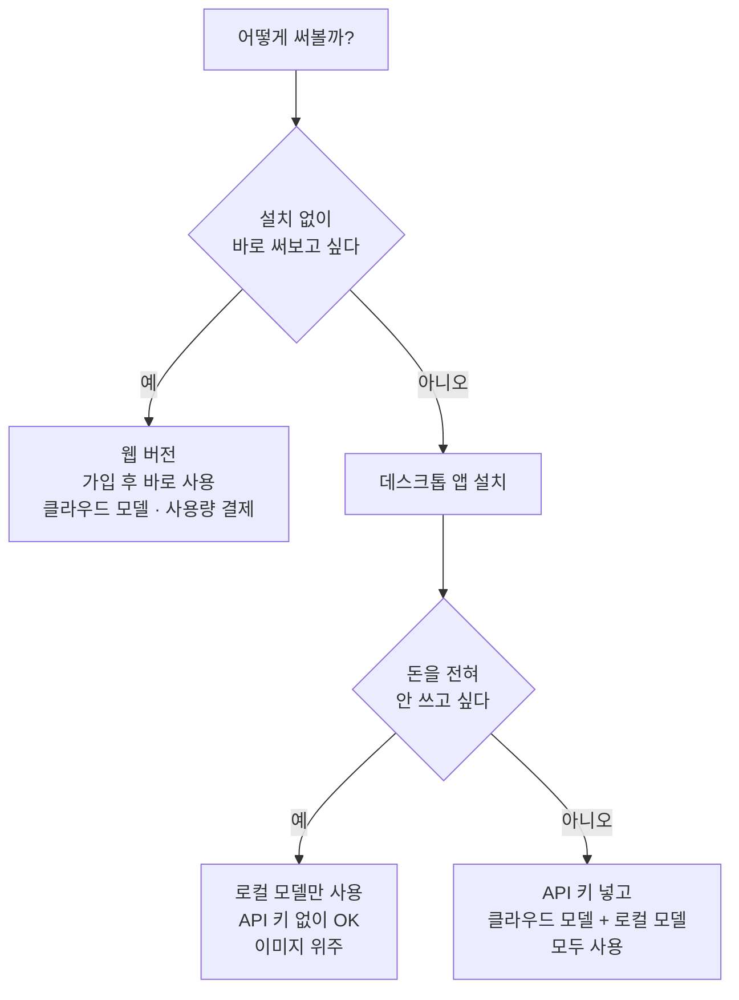

# 무료 오픈소스 AI 스튜디오 사용 가이드

> 이미지 · 영상 · 립싱크 · 음악을 **앱 하나**로 만들기
> 매달 AI 구독료를 내고 있다면, 이 도구부터 한번 써보세요.

**목차**
1. [이 도구로 할 수 있는 것](#1-이-도구로-할-수-있는-것)
2. [시작 전에 꼭 알아둘 3가지](#2-시작-전에-꼭-알아둘-3가지)
3. [나에게 맞는 사용 방법 고르기](#3-나에게-맞는-사용-방법-고르기)
4. [설치하기 (Windows / Mac)](#4-설치하기)
5. [처음 실행하고 API 키 넣기](#5-처음-실행하고-api-키-넣기)
6. [내 컴퓨터에서 무료로 이미지 만들기](#6-내-컴퓨터에서-무료로-이미지-만들기)
7. [스튜디오별 사용법 (이미지 · 영상 · 립싱크 · 음악)](#7-스튜디오별-사용법)
8. [생성 설정 직접 고르기](#8-생성-설정-직접-고르기)
9. [바로 따라 쓰는 프롬프트 예시](#9-바로-따라-쓰는-프롬프트-예시)
10. [고급: 내 컴퓨터에서 영상까지 만들기](#10-고급-내-컴퓨터에서-영상까지-만들기)
11. [자주 묻는 질문 · 문제 해결](#11-자주-묻는-질문--문제-해결)
12. [사용할 때 주의할 점](#12-사용할-때-주의할-점)

---

## 1. 이 도구로 할 수 있는 것

**Open Generative AI**는 깃허브에서 **3만 2천 개가 넘는 스타**를 받은 오픈소스 AI 스튜디오입니다.
여러 AI 서비스에 따로 가입하지 않아도, 앱 하나 안에서 아래 작업을 할 수 있어요.

| 하고 싶은 것 | 쓰는 곳 | 예시 |
|---|---|---|
| 🖼️ 이미지 만들기 | **Image Studio** | 글로 설명해서 이미지 생성, 내 사진을 다른 스타일로 바꾸기 |
| 🎬 영상 만들기 | **Video Studio** | 글로 영상 만들기, 사진 한 장을 움직이는 영상으로 |
| 🗣️ 립싱크 | **Lip Sync Studio** | 얼굴 사진 + 목소리 파일 → 말하는 영상 |
| 🎵 음악 만들기 | **Audio Studio** | 글로 설명해서 배경음악 · 오디오 생성 |
| 🎥 영화 같은 장면 | **Cinema Studio** | 카메라 · 렌즈 · 조리개를 골라 시네마틱한 장면 만들기 |

- **600개가 넘는 AI 모델**을 한곳에서 골라 쓸 수 있어요. (Flux, Nano Banana, Midjourney, Kling, Sora, Veo, Seedance 등)
- 일부 모델은 **내 컴퓨터에서 직접 실행**할 수 있어요. 이 경우 생성 비용이 들지 않아요.

---

## 2. 시작 전에 꼭 알아둘 3가지

처음 쓰는 분들이 가장 헷갈리는 부분이라, 먼저 정리할게요.

### ① 앱은 무료예요
앱을 내려받고 설치하는 데 돈이 들지 않아요. 월 구독도 없어요.

### ② 클라우드 모델은 "쓴 만큼" 결제해요
Kling, Sora, Veo, Midjourney 같은 유명 모델은 내 컴퓨터가 아니라 **인터넷 너머 서버(클라우드)** 에서 돌아가요.
이 모델들을 쓰려면 **MuAPI**라는 서비스의 **API 키**가 필요하고, **만들 때마다 요금**이 나가요.

| 방식 | 비용 구조 |
|---|---|
| 일반 AI 구독 서비스 | 많이 쓰든 적게 쓰든 **매달 고정 요금** |
| 이 도구 (클라우드 모델) | 구독 없이 **만든 만큼만** 결제 |
| 이 도구 (로컬 모델) | 내 컴퓨터로 만들기 때문에 **생성 비용 0원** |

> 💡 참고 가격 (MuAPI 요금 페이지 기준, 바뀔 수 있어요): 이미지 1장 약 $0.04, 고급 영상 모델 1개 약 $0.6.
> 정확한 가격은 [muapi.ai/pricing](https://muapi.ai/pricing)에서 꼭 확인하세요.

### ③ 로컬 실행은 "데스크톱 앱"에서만 돼요
내 컴퓨터에서 직접 돌리는 기능은 **설치형 데스크톱 앱**에서만 쓸 수 있어요. 웹 버전은 항상 클라우드 모델을 써요.
그리고 로컬 실행은 컴퓨터 사양에 따라 가능한 범위가 달라요.

| 내 컴퓨터 | 로컬로 할 수 있는 것 |
|---|---|
| 일반 노트북 · 맥북 (RAM 8GB) | 가벼운 이미지 모델 (Dreamshaper 8 등) |
| RAM 16GB 이상 | 고화질 이미지 모델 (Z-Image, SDXL)까지 |
| NVIDIA · AMD 그래픽카드 PC | 영상 모델까지 (별도 설치 필요, [10번](#10-고급-내-컴퓨터에서-영상까지-만들기) 참고) |

---

## 3. 나에게 맞는 사용 방법 고르기



- **처음이라 그냥 구경해 보고 싶다** → 웹 버전: [muapi.ai/open-generative-ai](https://muapi.ai/open-generative-ai)
- **돈 안 들이고 이미지부터 만들어 보고 싶다** → 데스크톱 앱 + 로컬 모델 (4 → 6번 순서로 따라 하세요)
- **영상 · 립싱크 · 음악까지 다 써보고 싶다** → 데스크톱 앱 + API 키 (4 → 5 → 7번)

---

## 4. 설치하기

### 내려받기
아래에서 내 컴퓨터에 맞는 파일 하나만 받으면 돼요. (현재 최신 버전 2.0.0)

| 내 컴퓨터 | 받을 파일 |
|---|---|
| **Windows** | [Open.Generative.AI.Setup.2.0.0.exe](https://github.com/Anil-matcha/Open-Generative-AI/releases/download/v2.0.0/Open.Generative.AI.Setup.2.0.0.exe) |
| **Mac (M1 · M2 · M3 · M4)** | [Open.Generative.AI-2.0.0-arm64.dmg](https://github.com/Anil-matcha/Open-Generative-AI/releases/download/v2.0.0/Open.Generative.AI-2.0.0-arm64.dmg) |
| **Mac (인텔)** | [Open.Generative.AI-2.0.0.dmg](https://github.com/Anil-matcha/Open-Generative-AI/releases/download/v2.0.0/Open.Generative.AI-2.0.0.dmg) |

> 내 맥이 M칩인지 인텔인지 모르겠다면: 화면 왼쪽 위 사과(애플) 메뉴 → **이 Mac에 관하여** → "칩"에 Apple M○ 이 보이면 M칩이에요.
>
> 새 버전이 나오면 [전체 버전 목록](https://github.com/Anil-matcha/Open-Generative-AI/releases)에서 가장 위에 있는 것을 받으세요.

### Windows 설치
1. 받은 `.exe` 파일을 더블클릭해요.
2. 파란색 **"Windows의 PC 보호"** 창이 뜨면 놀라지 마세요. 앱에 디지털 서명이 없어서 뜨는 경고예요.
   - **추가 정보** 클릭 → **실행** 클릭
3. 설치가 자동으로 끝나고 시작 메뉴에 앱이 생겨요.

### Mac 설치
1. 받은 `.dmg` 파일을 열고, 앱 아이콘을 **응용 프로그램(Applications)** 폴더로 끌어다 놓아요.
2. 처음 열면 "확인되지 않은 개발자" 경고로 막혀요. 아래 둘 중 편한 방법으로 풀어 주세요.

**방법 A — 터미널 없이 (추천)**
1. 앱을 한 번 열어 봐요 (막혀도 괜찮아요).
2. **시스템 설정 → 개인정보 보호 및 보안**으로 가요.
3. 아래로 내리면 *"Open Generative AI이(가) 차단되었습니다"* 가 보여요.
4. **그래도 열기** → **열기** 클릭

**방법 B — 터미널 사용**
터미널 앱을 열고 아래 한 줄을 붙여넣은 뒤 엔터:
```bash
xattr -cr "/Applications/Open Generative AI.app"
```
그다음 응용 프로그램 폴더에서 앱을 **오른쪽 클릭 → 열기 → 열기**.

> 한 번만 해 두면 다음부터는 그냥 열려요.

---

## 5. 처음 실행하고 API 키 넣기

> 🔸 **로컬 모델만 쓸 거라면 이 단계는 건너뛰어도 돼요.** 키 없이도 6번을 할 수 있어요.

클라우드 모델(Kling, Sora, Veo, 립싱크, 음악 등)을 쓰려면 MuAPI 키가 필요해요.

1. [muapi.ai](https://muapi.ai)에 가입해요.
2. 필요한 만큼 크레딧을 충전해요. (처음엔 소액으로 테스트해 보세요.)
3. [muapi.ai/access-keys](https://muapi.ai/access-keys)에서 새 키를 만들어요.
4. 생성된 **키 값(긴 문자열)** 을 복사해요.
   - ⚠️ 키에 붙인 **이름(라벨)** 이 아니라 **키 값 자체**를 복사해야 해요. 가장 많이 하는 실수예요.
5. 앱에서 처음 생성 버튼을 누르면 키 입력 창이 떠요. 여기에 붙여넣으면 끝!

> 🔐 API 키는 **비밀번호와 같아요.** 다른 사람에게 보여주거나 캡처해서 올리지 마세요.
> 앱은 키를 내 컴퓨터(브라우저 저장소)에만 저장하고 MuAPI 외 다른 곳으로 보내지 않아요.

---

## 6. 내 컴퓨터에서 무료로 이미지 만들기

API 키 없이, 생성 비용 0원으로 이미지를 만드는 방법이에요. **데스크톱 앱에서만** 돼요.

1. 앱에서 **Settings(설정) → Local Models** 를 열어요.
2. **sd.cpp inference engine** 을 설치해요. (버튼 한 번이면 자동으로 받아져요)
3. 모델을 하나 내려받아요. 처음이라면 아래 표를 참고하세요.
4. **Image Studio** 로 가서, 모델 선택 칸 옆의 **⚡ Local** 스위치를 켜요.
5. 방금 받은 모델을 고르고, 원하는 내용을 적은 뒤 **Generate(생성)**!

| 모델 | 용량 | 이런 분께 추천 |
|---|---|---|
| **Dreamshaper 8** | 2.1GB | 👉 **처음이라면 이것부터.** 가장 가볍고 무난해요. RAM 8GB 맥에서도 OK |
| **Realistic Vision v5.1** | 2.1GB | 실제 사진 같은 이미지 |
| **Anything v5** | 2.1GB | 애니메이션 · 일러스트 느낌 |
| **SDXL Base 1.0** | 6.9GB | 더 큰 해상도의 고화질 |
| **Z-Image Turbo** | 2.5GB + 보조 파일 2.7GB | 빠르고 고품질 (RAM 16GB 이상 권장) |
| **Z-Image Base** | 3.5GB + 보조 파일 2.7GB | 시간은 걸려도 최고 품질 (RAM 16GB 이상 권장) |

> ⚠️ **RAM 8GB 맥에서는 Z-Image 모델을 쓰지 마세요.** 컴퓨터가 멈출 수 있어요. Dreamshaper 같은 SD 1.5 계열을 쓰세요.
>
> 💾 모델 파일이 몇 GB씩 되니, 저장 공간을 미리 확인하세요. 모델은 앱 안에서만 받아지고, 컴퓨터 전체에 따로 설치되는 건 없어요.

---

## 7. 스튜디오별 사용법

> 아래 스튜디오들은 대부분 **클라우드 모델**을 써요. (5번의 API 키 필요)

### 🖼️ Image Studio — 이미지 만들기
- **글만 쓰면** → 글로 이미지를 만드는 모드 (50개 이상 모델)
- **참고 이미지를 올리면** → 그 이미지를 바꾸는 모드로 자동 전환 (55개 이상 모델)
- 일부 모델은 참고 이미지를 **최대 14장**까지 넣을 수 있어요. 고른 순서대로 번호가 붙어요.

### 🎬 Video Studio — 영상 만들기
- **글만 쓰면** → 글로 영상 만들기 (Kling, Sora, Veo, Seedance 등)
- **시작 이미지를 올리면** → 그 사진을 움직이는 영상으로 만들어요.
- 비율(9:16 세로 · 16:9 가로 등)과 길이(예: 5 · 10 · 15초)를 모델에 맞게 고를 수 있어요.

### 🗣️ Lip Sync Studio — 립싱크 영상
두 가지 방식이 있어요.

| 모드 | 넣는 것 | 나오는 것 |
|---|---|---|
| **Portrait Image** | 얼굴 사진 + 음성 파일 | 사진 속 인물이 말하는 영상 |
| **Video** | 기존 영상 + 음성 파일 | 입 모양을 새 음성에 맞춘 영상 |

**순서:** 모드 고르기 → 사진(또는 영상) 올리기 → 음성 파일 올리기 → (선택) 움직임 설명 적기 → 모델 · 해상도 고르기 → **Generate**

### 🎵 Audio Studio — 음악 · 오디오
원하는 분위기를 글로 적으면 AI가 음악 · 오디오를 만들어요. 릴스 배경음악이나 인트로 음악에 활용해 보세요.

### 그 밖의 스튜디오
| 스튜디오 | 하는 일 |
|---|---|
| **Cinema Studio** | 카메라 · 렌즈 · 초점거리 · 조리개를 골라 영화 같은 장면 |
| **AI Clipping** | 긴 영상에서 하이라이트 자동 추출 |
| **Marketing Studio** | 한 장의 이미지로 광고 소재 여러 버전 |
| **Workflow Studio** | 이미지 → 영상 → 음악처럼 여러 단계를 이어서 자동으로 |
| **Agent Studio** | 대화하듯 요청하면 AI가 알아서 계획하고 만들어 줘요 |

> 📂 만든 결과물은 **History(기록)** 에 남아서 다시 보고 원본 화질로 내려받을 수 있어요.

---

## 8. 생성 설정 직접 고르기

구독형 서비스는 정해진 모델과 옵션 안에서만 쓰는 경우가 많지만, 이 도구는 **내가 직접 고를 수 있는 것**이 많아요.

| 직접 고를 수 있는 것 | 설명 |
|---|---|
| **모델** | 600개 이상 중에서 목적에 맞게 선택 |
| **실행 위치** | ⚡ Local 스위치로 내 컴퓨터 실행 ↔ 클라우드 실행 전환 |
| **비율** | 세로(9:16), 가로(16:9), 정사각형 등 |
| **해상도 · 화질** | 모델이 지원하면 1K / 2K / 4K, 기본 / 고화질 |
| **영상 길이** | 모델이 지원하는 범위 안에서 선택 |
| **참고 이미지** | 모델에 따라 여러 장, 원하는 순서로 |
| **비용** | 로컬 모델은 0원, 클라우드는 만든 만큼만 |

> 💡 옵션은 **고른 모델에 따라 자동으로 바뀌어요.** 어떤 모델엔 해상도 옵션이 있고, 어떤 모델엔 없어요.

---

## 9. 바로 따라 쓰는 프롬프트 예시

> 💡 모델에 따라 **영어로 쓰면 더 정확하게** 나오는 경우가 많아요. 한국어로 먼저 써 보고, 결과가 아쉬우면 영어로 바꿔 보세요.

**이미지**
```
아늑한 카페 창가에 놓인 노트북과 라떼, 아침 햇살, 따뜻한 색감, 사진 같은 느낌
```
```
a cozy cafe window seat with a laptop and a latte, soft morning sunlight, warm tones, photorealistic
```

**영상 (사진을 움직이게)**
```
the camera slowly zooms in, steam rises from the coffee cup, leaves gently move outside the window
```

**음악**
```
calm lo-fi hip hop beat for a morning vlog, soft piano, 90 bpm
```

**잘 쓰는 요령**
1. **무엇을** (주인공) → **어디서** (배경) → **어떤 느낌** (색감 · 조명 · 스타일) 순서로 적기
2. 한 번에 완벽하게 쓰려 하지 말고, 결과를 보며 한 단어씩 고치기
3. 비싼 영상 모델을 쓰기 전에, **이미지로 먼저 구도를 잡고** 그 이미지를 영상으로 만들면 비용이 줄어요

---

## 10. 고급: 내 컴퓨터에서 영상까지 만들기

> ⚠️ **NVIDIA 또는 AMD 그래픽카드가 있는 PC**가 필요해요. 맥(M칩)에서는 직접 실행이 안 돼요.
> 처음이라면 이 단계는 건너뛰고 6번(이미지)까지만 해도 충분해요.

영상 모델을 로컬에서 돌리려면 **Wan2GP**라는 프로그램을 따로 설치해서 앱과 연결해요.

1. Wan2GP를 설치해요. ([설치 안내](https://github.com/deepbeepmeep/Wan2GP))
   ```bash
   git clone https://github.com/deepbeepmeep/Wan2GP
   cd Wan2GP
   install.bat
   ```
   (맥 · 리눅스는 `./install.sh`)
2. 앱에서 **Settings → Local Models → Wan2GP** 를 열어요.
3. Wan2GP 폴더 위치를 지정하고 **Save** → **Check** 를 눌러 연결을 확인해요.
4. **Video Studio** 에서 **⚡ Local** 을 켜고 모델을 골라요.
   - 모델 파일은 처음 쓸 때 자동으로 내려받아져요. 진행 막대로 확인할 수 있어요.

| 모델 | 특징 |
|---|---|
| **Wan 2.1 1.3B** | 👉 가장 가벼움. 480p, 그래픽카드 메모리(VRAM) 약 8GB |
| **Wan 2.2 14B** | 더 좋은 품질, 일반 그래픽카드에선 느려요 |
| **Hunyuan Video 1.5** | 480p 글 → 영상 |
| **LTX-2 Distilled** | 720p, 빠른 생성 |

> 💡 맥을 쓰는데 집에 게이밍 PC가 있다면, PC에 Wan2GP를 설치하고 같은 와이파이에서 맥 앱과 연결해 쓸 수도 있어요. (Settings의 Wan2GP 항목에 PC 주소 입력)

---

## 11. 자주 묻는 질문 · 문제 해결

**Q. 정말 무료예요?**
앱은 무료예요. 로컬 모델로 만드는 것도 무료예요. 다만 클라우드 모델(Kling, Sora, Veo 등)은 MuAPI에서 **만든 만큼** 요금이 나가요. 매달 고정으로 나가는 구독료는 없어요.

**Q. 설치할 때 바이러스 경고 같은 게 떠요.**
앱에 디지털 서명이 없어서 뜨는 경고예요. 위 [4번](#4-설치하기)의 방법(Windows: 추가 정보 → 실행 / Mac: 그래도 열기)으로 진행하세요. 파일은 꼭 이 가이드의 공식 다운로드 링크에서만 받으세요.

**Q. API 키를 넣었는데 안 돼요.**
키의 **이름(라벨)** 을 넣은 건 아닌지 확인하세요. 긴 문자열인 **키 값**을 넣어야 해요. 크레딧이 충전되어 있는지도 확인하세요.

**Q. 로컬로 이미지를 만드는데 너무 느려요 / 컴퓨터가 멈췄어요.**
- 더 가벼운 모델(Dreamshaper 8)로 바꿔 보세요.
- RAM 8GB 맥에서는 Z-Image를 쓰지 마세요.
- 다른 프로그램을 닫고 다시 해 보세요.

**Q. 모델 파일이 C 드라이브를 너무 많이 차지해요.**
모델은 기본적으로 아래 위치에 저장돼요.
- Windows: `%APPDATA%\open-generative-ai\local-ai`
- Mac: `~/Library/Application Support/open-generative-ai/local-ai`

다른 드라이브에 저장하고 싶다면, 앱을 실행하기 전에 환경 변수 `OPEN_GENERATIVE_AI_LOCAL_AI_DIR` 에 원하는 폴더를 지정하세요. 실제 저장 위치는 **Settings → Local Models** 에서 확인할 수 있어요.

**Q. 맥에서 영상 모델을 로컬로 돌릴 수 있나요?**
아니요. 영상 로컬 실행(Wan2GP)은 NVIDIA · AMD 그래픽카드가 필요해요. 맥에서는 이미지 로컬 모델 + 클라우드 영상 모델 조합을 추천해요.

**Q. 휴대폰에서도 되나요?**
웹 버전은 모바일 화면에서도 쓸 수 있어요. 로컬 실행은 데스크톱 앱에서만 돼요.

---

## 12. 사용할 때 주의할 점

- **다른 사람의 얼굴 · 목소리**를 허락 없이 립싱크나 영상에 쓰지 마세요. 초상권 · 명예훼손 문제가 될 수 있어요.
- **유명 캐릭터 · 브랜드 · 작품**을 그대로 따라 만든 결과물은 저작권 문제가 생길 수 있어요.
- 결과물을 **상업적으로 쓸 때**는 사용한 모델의 이용 약관(라이선스)을 확인하세요. 모델마다 달라요.
- 인스타그램 · 유튜브에 올릴 때는 각 플랫폼 규정에 따라 **AI 생성 콘텐츠 표시**를 해 주세요.

---

<p align="center">
이 가이드는 오픈소스 프로젝트 <a href="https://github.com/Anil-matcha/Open-Generative-AI">Open-Generative-AI</a>를 초보자용으로 쉽게 정리한 비공식 안내서예요.<br/>
앱의 기능과 가격은 업데이트에 따라 바뀔 수 있어요.
</p>

<p align="center"><b>플랫폼트리</b> · @platformtree</p>
